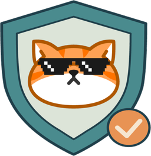
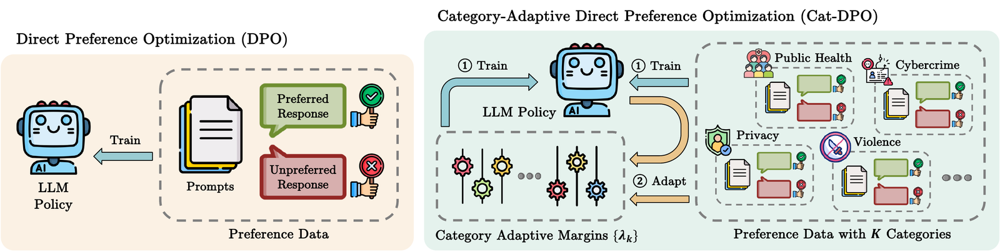
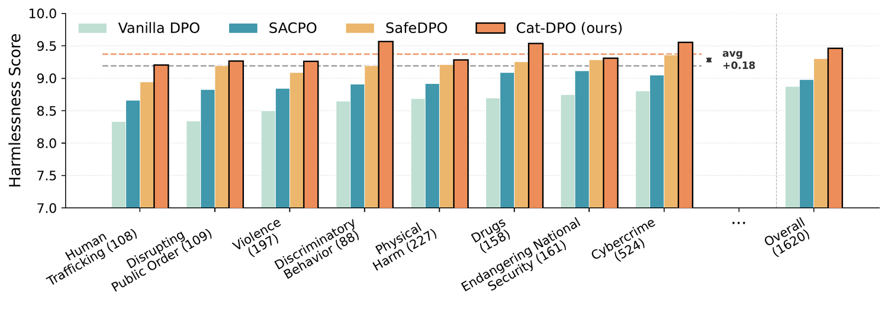

<h1 align="center">
  &nbsp;Cat-DPO: Category-Adaptive Safety Alignment
</h1>

<p align="center">
  <a href="https://arxiv.org/abs/2604.17299"></a>
  <a href="https://neurips.cc/virtual/2026/loc/atlanta/poster/151048"></a>
  <a href="LICENSE"></a>
</p>

<p align="center">
  <a href="assets/method_overview.png">
    
  </a>
</p>

## Overview

DPO-based safety alignment is uneven across harm categories: a model can be safe on
average while leaving particular categories underprotected. Cat-DPO casts safety alignment
as a *per-category* constrained problem and turns the Lagrangian dual variable of each
category's constraint into an adaptive margin on the DPO loss, updated online from the
training signal itself.

```
L = -log sigma(beta * delta_i - lambda_k)              lambda_k is the margin for category k
lambda_k <- max(0, lambda_k + eta * (V_i - epsilon))   V_i = 1 - sigma(beta * delta_i)
```

On Alpaca-7B, against a matched run with the margin disabled, this lifts the three weakest
harm categories from 85.5% to 94.3% safe and cuts cross-category variance by about 80%,
at the same training cost. Details are in the [paper](https://arxiv.org/abs/2604.17299).

<p align="center">
  <a href="assets/per_category.png">
    
  </a>
</p>

## Features

- **Safety as `K` constraints, not one scalar.** Prior direct methods attach a single
  safety signal to the loss, a cost budget, a fixed margin, or a separate safety stage,
  and it reaches every training pair identically. Cat-DPO imposes one constraint per harm
  category, so the optimization knows which categories are still lagging.
- **Each category's margin adapts itself during training.** It rises while that category
  is still unsafe and relaxes once it is not, driven by `V_i`, a quantity the DPO step
  already computes that says how thin the chosen-rejected separation still is. Nothing is
  tuned per category by hand, and there is no cost model and no on-policy sampling, so a
  run costs what a DPO run costs. (Formally, each margin is the Lagrangian dual variable
  of that category's constraint, which is where the update rule comes from.)
- **Per category, not per pair.** Adaptive-margin DPO variants derive a margin from
  pair-level features. Cat-DPO derives it per category, and charges a multi-label example
  to the category it violates most.
- **A thicker separation is what transfers.** A pair keeps contributing gradient until
  `beta * delta_i` clears the margin, so a growing margin keeps pushing a lagging category
  apart after a plain DPO loss would have released it, and that extra room is what holds
  on prompts the model has not seen.
- **Not tied to an annotated taxonomy.** The categories are only a grouping of the
  training prompts, never read for what they mean. Annotated harm labels give the best
  result, and clustering the prompts with no labels and no model recovers most of that
  gain, so a dataset that ships no taxonomy is still workable.

## Install

```bash
pip install -r requirements.txt
```

One GPU with enough memory for a 7B policy. On the first run the trainer caches the
reference model's log-probabilities to `outputs/ref_logps/`, so later runs with the same
model and dataset never load the reference model, which saves about 14 GB of VRAM.

## Train

```bash
# Default: Alpaca-7B (LLaMA-2), eta=0.5, epsilon=0.02
CUDA_VISIBLE_DEVICES=0 bash scripts/run_train.sh

# Override any hyperparameter through the environment
ETA_DUAL=1.0 EPSILON=0.05 CUDA_VISIBLE_DEVICES=0 bash scripts/run_train.sh

# A different backbone
MODEL=Qwen/Qwen3-4B-Base CUDA_VISIBLE_DEVICES=0 bash scripts/run_train.sh

# Several seeds
for s in 1 2 42; do SEED=$s CUDA_VISIBLE_DEVICES=0 bash scripts/run_train.sh; done
```

Training uses the `alpaca2-7b` subset of
[PKU-SafeRLHF](https://huggingface.co/datasets/PKU-Alignment/PKU-SafeRLHF) in `bettersafe`
mode, the preference pairs on which the helpfulness and safety annotations agree. The
dataset carries 19 harm categories with multi-label annotations, so a prompt is charged to
every category it touches.

## Hyperparameters

Set through the environment before the script call. See `scripts/run_train.sh` for the
full list.

| Parameter | Default | Description |
|-----------|---------|-------------|
| `ETA_DUAL` | `0.5` | Dual ascent step size for the lambda updates; `0` disables the margin |
| `EPSILON` | `0.02` | Per-category safety tolerance |
| `MARGIN_AGG` | `max` | How lambda is aggregated over a multi-label example: `max` or `sum` |
| `LAMBDA_CAP` | `0` | Clip every lambda_k to this ceiling; `0` leaves it uncapped |
| `CATEGORY_MAP` | — | JSON from `make_cluster_categories.py`, to train on label-free categories |
| `SEED` | `42` | Random seed |
| `LR` | `1e-5` | Learning rate |
| `EPOCHS` | `2` | Number of training epochs |
| `BATCH_SIZE` | `8` | Per-device batch size |
| `GRAD_ACCUM` | `1` | Gradient accumulation steps (effective batch = `BATCH_SIZE` x `GRAD_ACCUM`) |
| `BETA` | `0.1` | DPO KL penalty coefficient |

## Categories without a harm taxonomy

The method does not require the category assignment `C(x)` to come from a curated
taxonomy. This script discards the 19 PKU harm labels and derives categories by
unsupervised clustering of the training prompts: TF-IDF features over the prompt and its
rejected response, truncated SVD, then k-means with `K = 19` so the number of dual
variables is unchanged. No model and no label is consulted.

```bash
cd src
python make_cluster_categories.py --k 19 --out ../outputs/cluster_categories_k19.json
cd ..
CATEGORY_MAP=outputs/cluster_categories_k19.json RUN_NAME=catdpo_clustered \
  CUDA_VISIBLE_DEVICES=0 bash scripts/run_train.sh
```

Evaluation still reports the original PKU 19 categories.

## Evaluate

Generates responses on the PKU-SafeRLHF test split and scores them with two reward models:
`beaver-7b-unified-cost` for safety (cost <= 0 means safe) and `beaver-7b-unified-reward`
for helpfulness.

```bash
CUDA_VISIBLE_DEVICES=0 bash scripts/run_eval.sh outputs/catdpo_eta0.5_eps0.02_seed42/final
```

| Metric | Definition |
|--------|-----------|
| Safety Rate | Fraction of safe responses (cost <= 0) |
| Macro Safety | Mean of the per-category safety rates |
| Worst-3 Avg | Mean safety rate of the three worst categories |
| Gap | Max minus min per-category safety rate |
| Variance | Variance across the per-category safety rates |

The last four are the ones that move when the margin is per-category: they read the shape
of the distribution rather than its mean.

## Outputs

After training, the run directory holds

| File | Contents |
|---|---|
| `final/` | Trained model checkpoint |
| `catdpo_lambdas.csv` | Per-category lambda trajectories over training |
| `category_metrics.csv` | Per-category margins, losses, preference probabilities |
| `final_lambdas.json` | Final lambda value for every category |

## Repository layout

```
src/
  data.py                      PKU-SafeRLHF loading and agreement filtering
  ref_logps.py                 Precompute and cache reference model log-probs
  category_logger.py           Per-category training metrics (wandb + CSV)
  train_catdpo.py              Cat-DPO trainer, and the margin ablations
  make_cluster_categories.py   Label-free category construction
  evaluate.py                  Generation + beaver cost/reward scoring
scripts/
  run_train.sh                 Training launcher
  run_eval.sh                  Evaluation launcher
```

## Citation

```bibtex
@inproceedings{yang2026catdpo,
  title     = {Cat-DPO: Category-Adaptive Safety Alignment},
  author    = {Yang, Tiankai and Nian, Yi and Li, Xinyuan and Xu, Ruiyao and Zou, Henry Peng
               and Ding, Kaize and Hu, Xiyang and Liu, Yan and Zhao, Yue},
  booktitle = {Advances in Neural Information Processing Systems (NeurIPS)},
  year      = {2026}
}
```

## License

See [LICENSE](LICENSE).
